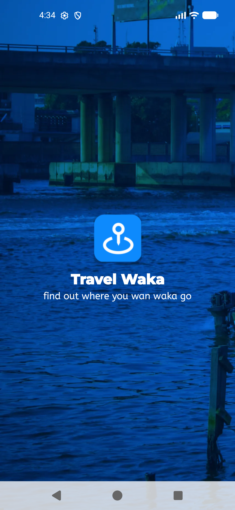
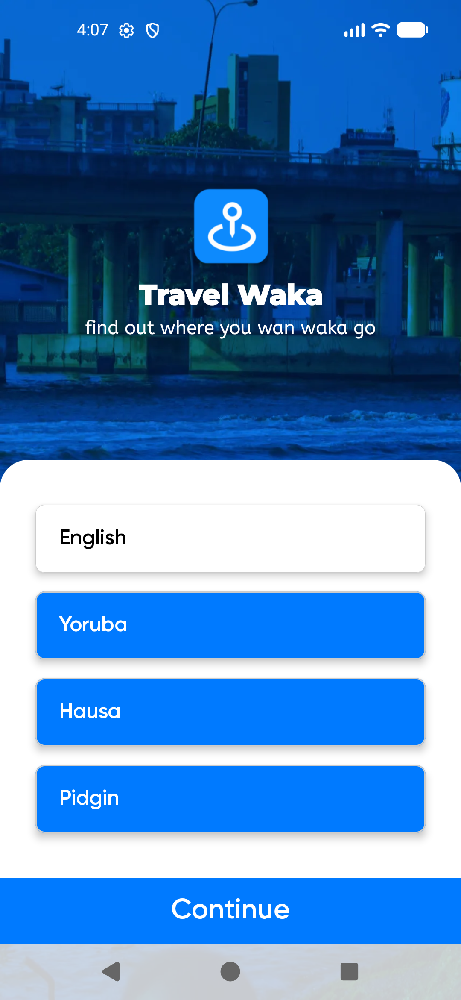
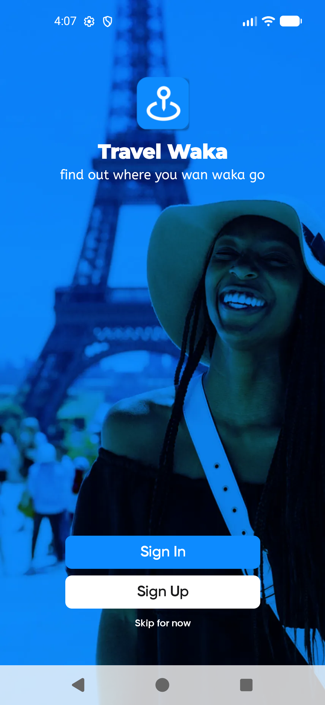
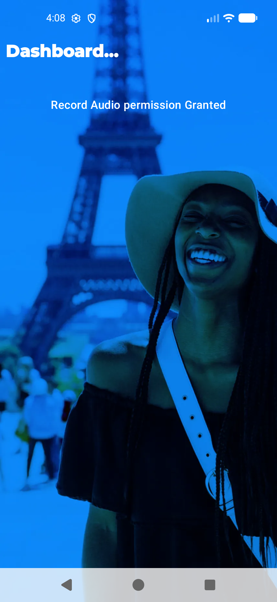

# TravelWaka

TravelWaka is a modern **Kotlin Multiplatform (KMP)** mobile application designed to help travelers "find out where you want waka go". It offers a seamless experience across **Android** and **iOS** using a shared codebase for business logic and UI.

## 📱 Screenshots

| Splash Screen | Language Selection | Login Onboarding | Dashboard |
| :---: | :---: | :---: | :---: |
|  |  |  |  |

## ✨ Features

- **Multi-language Support:** Choose from English, Yoruba, Hausa, and Pidgin.
- **Onboarding Experience:** Smooth transition from splash to language selection and login.
- **Authentication:** Integrated sign-in and sign-up flows (Work in Progress).
- **Dashboard:** A central hub for exploring travel destinations.
- **Local Persistence:** Powered by Room for offline-first capabilities.
- **Dependency Injection:** Modular and testable architecture using Koin.

## 🚀 Tech Stack

- **UI Framework:** [Compose Multiplatform](https://www.jetbrains.com/lp/compose-multiplatform/)
- **Networking:** [Ktor](https://ktor.io/)
- **Dependency Injection:** [Koin](https://insert-koin.io/)
- **Local Database:** [Room](https://developer.android.com/training/data-storage/room)
- **Image Loading:** [Coil 3](https://coil-kt.github.io/coil/)
- **Navigation:** [Navigation 3](https://developer.android.com/guide/navigation/navigation-3)
- **Logging:** [Napier](https://github.com/AAkira/Napier)
- **Permissions:** [MOKO Permissions](https://github.com/icerockdev/moko-permissions)

## 📁 Project Structure

- `composeApp/`: Shared Kotlin Multiplatform module.
  - `commonMain/`: Shared logic and UI (Compose).
  - `androidMain/`: Android-specific implementations.
  - `iosMain/`: iOS-specific implementations.
- `iosApp/`: iOS entry point and SwiftUI wrapper.

## 🛠️ Build and Run

### Android
- Open in Android Studio and run the `composeApp` configuration.
- From terminal:
  ```bash
  ./gradlew :composeApp:assembleDebug
  ```

### iOS
- Open the `iosApp` directory in Xcode or run from Android Studio if configured.
- Ensure you have a Mac with Xcode installed.

---

*TravelWaka - Find out where you want waka go.*
